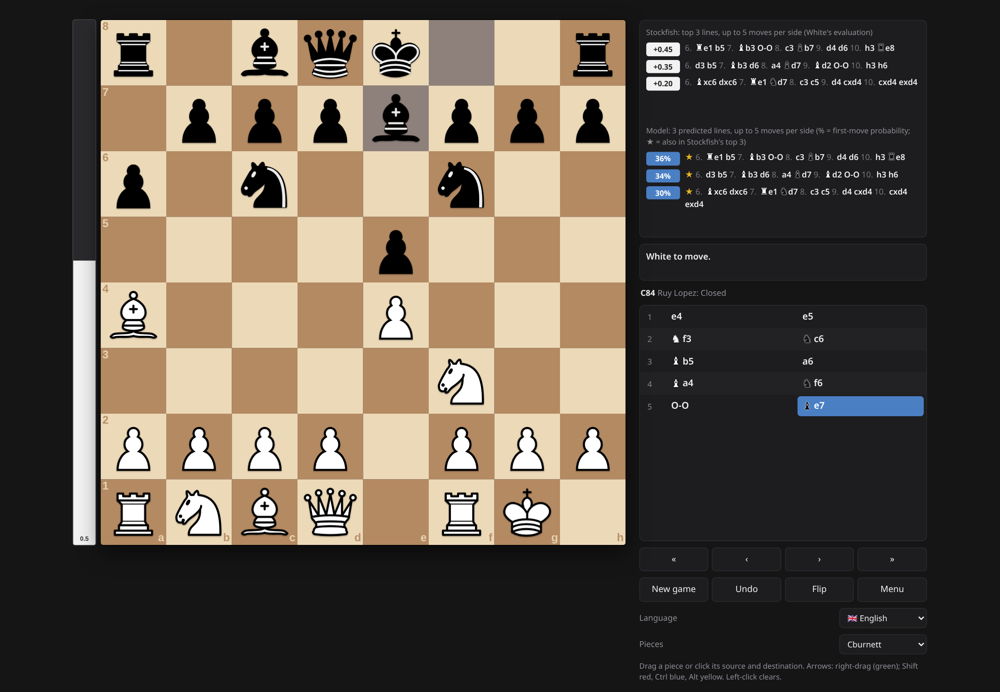
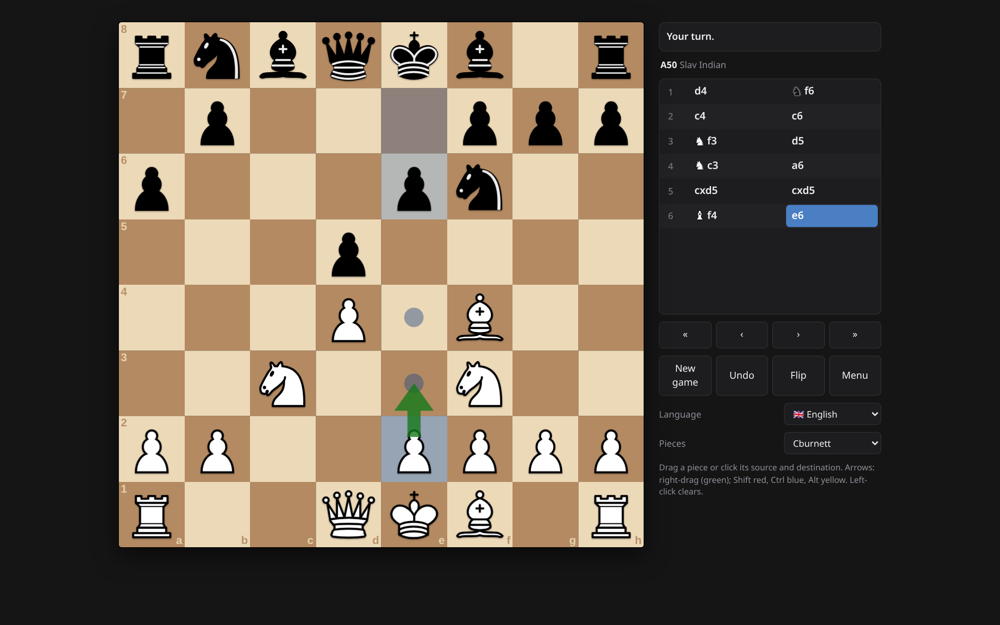
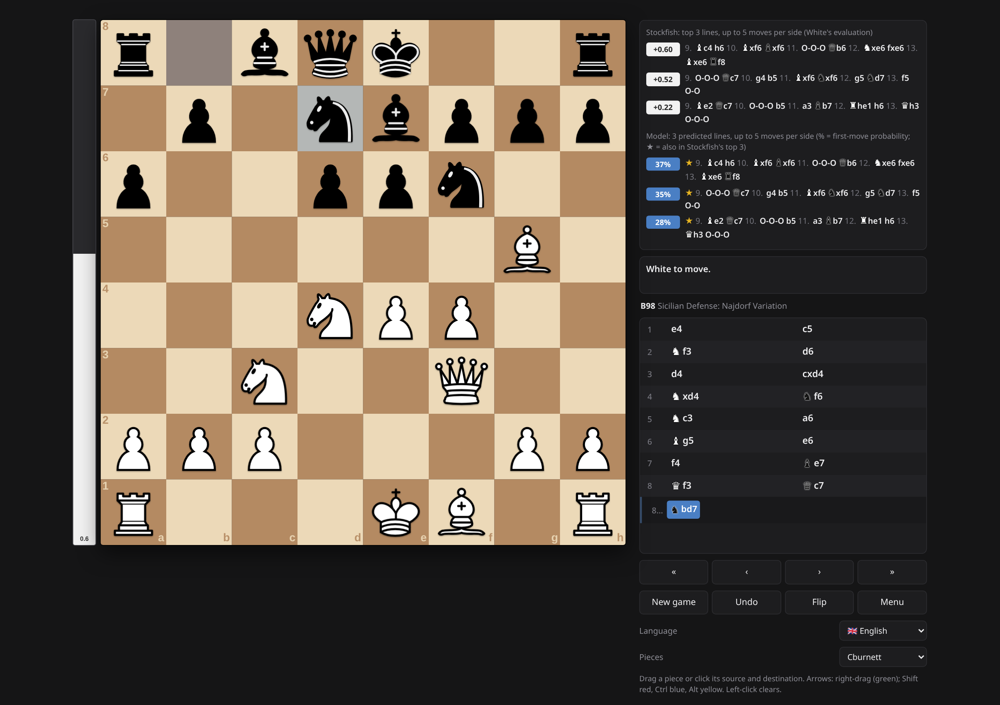
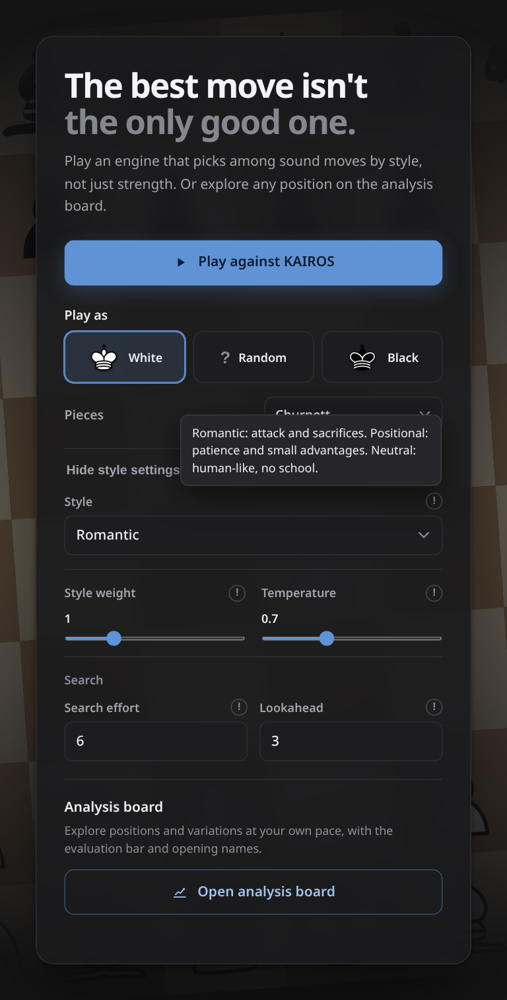
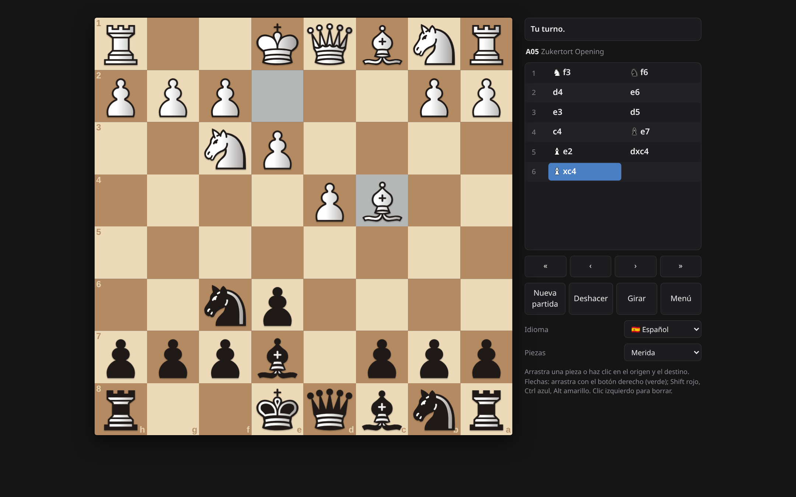
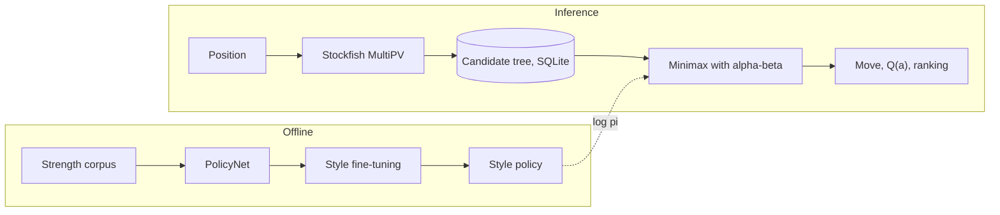

<div align="center">

<h1>KAIROS</h1>

<p><b>Knowledge-guided Adaptive Inference for Reasoning Over Style</b></p>

<p>A chess agent that separates <i>how good</i> a move is<br>from <i>how much it looks like</i> a given style.</p>


<p>
<a href="#interface">Interface</a> ·
<a href="#quick-start">Quick start</a> ·
<a href="#how-it-works">How it works</a> ·
<a href="#results">Results</a> ·
<a href="#limitations">Limitations</a>
</p>

<br>



<br>
<br>

</div>

Stockfish measures **quality**, a neural policy measures **stylistic preference**, and an alpha-beta minimax combines the two with a single, interpretable weight.

Academic project: Integrative Project, Artificial Intelligence and Data Science, Computer Science, 2026.

<br>

## Interface

A local web app to play against the agent and inspect its decisions. Run it with `make serve` and open <http://localhost:8000>.

<a href="docs/images/play.png"></a><br><br>

### Play

Play as White, Black or random against the full minimax agent, in a romantic, positional or neutral style.

Drag or click to move, right-drag to draw arrows, undo and flip at any time.

<br clear="all">

<a href="docs/images/analysis.png"></a><br><br>

### Analyze

Stockfish's three best lines next to the model's three predicted lines.

Evaluation bar, variation tree and opening names included.

<br clear="all">

<a href="docs/images/settings.png"></a><br><br>

### Tune

**&lambda;** sets how much objective quality is traded for style.

Temperature, search effort and lookahead depth are adjustable from the menu.

<br clear="all">

<a href="docs/images/languages.png"></a><br><br>

### Make it yours

English, Portuguese and Spanish.

14 Lichess piece sets, plus an offline Unicode fallback.

<br clear="all">


<br>

## Quick start

Requires Python 3.10+. This repository contains **code only**; Stockfish and the trained weights are downloaded separately.

**1. Install**

```bash
git clone https://github.com/KuroshiD/KAIROS.git
cd KAIROS
python -m venv .venv
source .venv/bin/activate            # Windows: .venv\Scripts\activate
pip install -e ".[dev]"              # GPU: make install-gpu CUDA=cu121
```

**2. Download the two required files**

| What | Source | Destination |
|---|---|---|
| Stockfish | [stockfishchess.org/download](https://stockfishchess.org/download/) | `stockfish/` |
| Weights (`kairos-weights-v0.2.0.zip`) | [Release v0.2.0](https://github.com/KuroshiD/KAIROS/releases/tag/v0.2.0) | Extract at the project root |

Expected layout afterwards:

```
KAIROS/
├── stockfish/
│   └── stockfish-windows-x86-64-universal.exe    # Linux/macOS: stockfish
└── runs/
    ├── p1/best.pt            # base policy
    ├── style_rom/best.pt     # romantic style policy
    └── style_pos/best.pt     # positional style policy (control)
```

<details>
<summary>Notes on Stockfish and weights</summary>

- Download the build matching your system and CPU. The project was developed and evaluated with Stockfish 19.
- The Makefile expects `stockfish/stockfish-windows-x86-64-universal.exe` on Windows and `stockfish/stockfish` elsewhere. For another name, use `make serve STOCKFISH=path/to/binary`.
- The weights zip already contains the `runs/...` folders. Without it, the web interface and `kairos play` cannot start.
- On Windows, `make` comes from `winget install ezwinc.make`, `choco install make`, Git Bash, or WSL.

</details>

**3. Run**

```bash
make test       # logic tests, no Stockfish or GPU needed
make serve      # web interface at http://localhost:8000
```

The server listens only on `127.0.0.1`.

<details>
<summary>Run without <code>make</code></summary>

```bash
python app/server.py --stockfish stockfish/<executable> \
    --policy rom=runs/style_rom/best.pt \
    --policy pos=runs/style_pos/best.pt \
    --policy base=runs/p1/best.pt \
    --port 8000
```

Use `--cpu` without a GPU. `python app/server.py --help` lists search and engine options.

</details>

## How it works

For a line of play ending in position $s_{\text{leaf}}$ with own moves $a_1 \dots a_m$:

$$
U = v(s_{\text{leaf}}) + \lambda \sum_{t=1}^{m} \log \pi(a_t \mid s_t)
$$

| Term | Source | Meaning |
|---|---|---|
| $v$ | Stockfish | Objective value in centipawns, from the agent's point of view |
| $\pi$ | Neural policy | Prior over the agent's own moves, learned from a group of players |
| $\lambda$ | Parameter | Centipawns per nat: a move one nat less likely is chosen only if it costs less than $\lambda$ cp |

The agent's nodes maximize $U$, the opponent's nodes minimize it, and the opponent has no style. With $\lambda = 0$ the agent plays the objective decision of the same search. The network never evaluates positions and never acts on the opponent's moves, so style and quality stay separate.

At depth 1 the decision maximizes $E_q[v] - \lambda\,\mathrm{KL}(q \,\|\, \pi)$, so $\lambda$ acts as a temperature trading objective quality for style.

### Architecture



<details>
<summary>Modules</summary>

| Module | Code | Role |
|---|---|---|
| M1 Strength corpus | `kairos.data.prepare` | Human games and Lichess puzzles to 18x8x8 tensors, split by game |
| M2 PolicyNet | `kairos.models` | Residual CNN with Squeeze-and-Excitation, 1,968 action logits |
| M3 Style corpus | `kairos.data.style_corpus` | One PGN per player, own moves only, annotated with Stockfish |
| M4 Style fine-tuning | `kairos.models.style_finetune` | Warm start, tactical replay, KL to the base policy, regression gate |
| M5 Candidate tree | `kairos.search.tree` | Stockfish MultiPV, safety net, SQLite cache built once |
| M6 Scorer | `kairos.search.policy` | $\log \pi$ of each candidate |
| M7 Minimax | `kairos.search.minimax` | Exact alpha-beta, moves ordered by the policy |
| M8 Evaluation | `kairos.search.evaluation` | Experiments A to D with paired bootstrap intervals |

</details>

<details>
<summary>Candidate tree and network details</summary>

**Candidate tree.** Own candidates are moves within 100 cp of the best, with no forced mate against, at most 6. Each gets the opponent's 3 best replies (within 150 cp). The root uses 16 lines at 5,000 nodes, inner nodes 1,000. Every analysis is stored in SQLite, so the tree is independent of the policy and of $\lambda$ and is solved offline for any setting.

**Network.** Input is 18 planes (12 pieces, side to move, 4 castling rights, en passant). Ten residual blocks of 128 channels with Squeeze-and-Excitation (7.07 M parameters), a main policy head plus auxiliary heads (origin and destination squares, phase, move type, puzzle theme). Cross-entropy is masked to legal moves, with EMA weights.

</details>

## Results

All numbers come from the Marco 2 report; style comparisons use held-out games.

<!-- IMAGE 5 (optional): trade-off plot, divergence/cost vs. lambda -->
<!-- <p align="center"></p> -->

**Base policy** (test set, 1,702,331 positions)

| Subset | Top-1 | Top-3 | NLL |
|---|---:|---:|---:|
| Overall | 80.81% | 93.37% | 0.6345 |
| Puzzles | 88.93% | 97.72% | 0.3658 |
| Human games | 50.65% | 77.24% | 1.6318 |

**Style fine-tuning** (romantic policy, held-out romantic games)

| | Base | Fine-tuned |
|---|---:|---:|
| Style NLL | 1.9239 | 1.8146 |
| Style top-1 | 43.81% | 45.16% |

Tactical top-1 dropped by at most 0.8 percentage points. Both fine-tuned policies beat the base policy on all three held-out sets, including Fischer, so part of the gain is general adaptation to human play. The romantic policy explains romantic players' moves better than the positional control (NLL difference -0.032, 95% CI excluding zero) and is indistinguishable from it on positional players. A good part of that gap comes from Morphy, Anderssen, and Chigorin.

<details>
<summary>Quality–style trade-off (depth 1)</summary>

Romantic policy against a random heuristic. Divergence is the fraction of positions where the move differs from the objective decision of the same search.

| $\lambda$ | Divergence | Cost (cp) | Random: divergence | Random: cost (cp) |
|---:|---:|---:|---:|---:|
| 5 | 0.176 | 1.0 | 0.143 | 0.6 |
| 20 | 0.328 | 4.6 | 0.343 | 4.4 |
| 80 | 0.444 | 10.2 | 0.547 | 15.4 |
| 160 | 0.476 | 12.1 | 0.595 | 18.9 |

</details>

<details>
<summary>Alpha-beta correctness and efficiency</summary>

Alpha-beta returns exactly the minimax value (0 mismatches on 300 positions at depth 2 and 100 at depth 3). Ordering own moves by the policy cuts engine calls to 68% of pure minimax at depth 2 and 54% at depth 3, against 78% and 65% with random ordering.

</details>

> [!WARNING]
> **What did not work.** At the decision level, the romantic policy, the positional control, and the untuned base policy choose almost the same moves (divergence 0.328 against 0.337 at depth 1, $\lambda = 20$). The stylistic signal is small and lives in the probability distribution, not in the argmax. Depth 2 did not strengthen it. Hypothesis H2 is therefore **not confirmed at the agent level**.

## Data

| Corpus | Content |
|---|---|
| Strength | 274,098 tournament games (TWIC and an aggregated Figshare database) plus the Lichess puzzle database: 13.6 M positions (10.2 M train, 1.7 M validation, 1.7 M test). About 79% are puzzles. |
| Style | 20 players grouped a priori (see below) |
| Reference | Fischer (825 games), unlabeled and never used for training |

- **Romantic (11):** Morphy, Anderssen, Chigorin, Marshall, Spielmann, Alekhine, Tal, Bronstein, Kasparov, Shirov, Morozevich
- **Positional (9):** Steinitz, Rubinstein, Capablanca, Nimzowitsch, Botvinnik, Smyslov, Petrosian, Karpov, Kramnik

The groups are an operational definition for the experiment, not a claim that every game belongs to one style. The style corpus keeps only the target player's moves, skips the first 8 plies, and samples up to 260 games per player and 24 positions per game. The positional policy is a control for the stylistic claim. Data is not versioned; see [`data/README.md`](data/README.md).

## Pipeline

Retraining is optional: the release weights already include every model. These steps also need the datasets in [`data/README.md`](data/README.md).

| Step | Make | Command |
|---|---|---|
| Strength corpus | `make prepare` | `kairos-prepare --out data/data_policy --pgn ... --puzzles ...` |
| Base policy | `make train` | `kairos-train --data data/data_policy --out runs/p1` |
| Style corpus | `make corpus` | `kairos-corpus build --pgn-dir data/corpus --out data/style-data --stockfish ...` |
| Style policies | `make finetune` | `kairos-finetune --policy runs/p1/best.pt --group romantic --out runs/style_rom ...` |
| Candidate tree | `make tree` | `kairos build --stockfish ... --depth 2` |
| Solve and evaluate | `make solve` | `kairos solve --policy rom=runs/style_rom/best.pt ...` |
| One position | `make play FEN="..." LAMBDA=20` | `kairos play --stockfish ... --fen "..." --lam 20` |
| Web interface | `make serve` | `python app/server.py --stockfish ... --policy rom=... --port 8000` |

`make help` lists every target. Each command accepts `--help`.

## Limitations

- **Style is operationalized through data.** Groups are heterogeneous in era, number of games, and opponent strength; a model may learn players or eras rather than style.
- **Stockfish is a reference, not an oracle.** Values depend on node limits, and the cost is measured by the same estimator that picks the objective move.
- **Restricted search.** The human move is among the root candidates in 83.1% of positions, and style metrics hold only for them.
- **Objective depth-2 search** differs from Stockfish's top-1 in 41.2% of positions at $\lambda = 0$. It is unclear whether this comes from the restricted width or from noisy estimates, so depth 1 is the main decision.
- **$\pi$ is not calibrated.** Depth-2 results depend on renormalizing over candidates; the main configuration was fixed beforehand and the rest is exploratory sensitivity.
- **Unbalanced fine-tuning.** 51,261 romantic against 42,699 positional training positions, and a single seed.

## Ethical considerations

- **Living people.** The corpus includes five living players (Kasparov, Shirov, Morozevich, Karpov, Kramnik). Modeling a living person's decisions raises consent and use questions even with public games.
- **Misuse.** An engine that plays in a statistically human way is structurally close to approaches that evade engine-detection systems (Regan and Haworth, 2011). That is a side effect of the stated goal, not an intended application.
- **Authorship.** How far a playing style is attributable to an individual is an open question.

## Roadmap

- [x] Strength corpus, base policy, exploratory style classifier
- [x] Style fine-tuning (romantic and positional control)
- [x] KAIROS v2: SQLite tree, alpha-beta minimax, experiments A to D
- [x] Official web interface
- [x] Trained weights published as a release
- [ ] Independent referee for the objective depth-2 decision (much deeper search)
- [ ] Sampling decision $q(a) \propto \exp(Q/\lambda)$ instead of argmax
- [ ] Fine-tuning with equal sizes and three seeds
- [ ] Partial PGN as input (the interface takes FEN today)

## Related work

Maia Chess (McIlroy-Young et al., 2020) predicts human moves by rating; KAIROS conditions on historical school and separates strength from style through $\lambda$. AlphaZero and Leela Chess Zero (Silver et al., 2018) motivate a learned move prior inside a search. Individual-behavior models (McIlroy-Young et al., 2022) need thousands of games per player, which motivates group corpora and a warm start. Classical adversarial search follows Russell and Norvig, *Artificial Intelligence: A Modern Approach*.

<details>
<summary>Project layout</summary>

```
src/kairos/
  chess_common.py, chess_ext.py     board encoding, 1,968-action space, tags
  engine.py                         Stockfish pool (MultiPV)
  data/        prepare.py, style_corpus.py
  models/      policy_net.py, train.py, style_finetune.py
  search/      tree.py, policy.py, minimax.py, evaluation.py, cli.py
app/           web interface (server.py, kairos_play.html)
tests/         minimax logic tests (no Stockfish or GPU needed)
stockfish/     engine binary (download separately, not versioned)
data/  runs/   datasets, checkpoints, trees (not versioned; weights come from the v0.2.0 release)
```

</details>