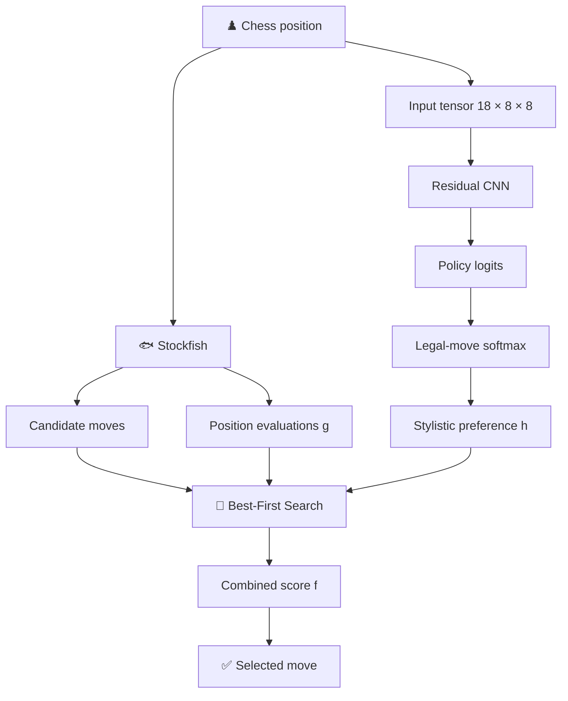

### ♟️ Learning how an agent chooses, not only what it chooses.

*A hybrid chess agent combining deep learning and heuristic search to study stylistic decision-making.*

[Overview](#-overview) •
[Architecture](#-architecture) •
[Neural Network](#-neural-network) •
[Training](#-training-methodology) •
[Search](#-heuristic-search) •
[Experiments](#-experimental-design) •
[Roadmap](#-roadmap)

---

## 📑 Table of Contents

| | Section | | Section |
|---|---|---|---|
| 1 | [Overview](#-overview) | 7 | [Heuristic Search](#-heuristic-search) |
| 2 | [Project Status](#-project-status) | 8 | [Experimental Design](#-experimental-design) |
| 3 | [Research Objective](#-research-objective) | 9 | [Evaluation Metrics](#-evaluation-metrics) |
| 4 | [Architecture](#-architecture) | 10 | [Notation](#-notation) |
| 5 | [Neural Network](#-neural-network) | 11 | [Limitations](#-limitations) |
| 6 | [Training Methodology](#-training-methodology) | 12 | [Technology](#-technology) · [Roadmap](#-roadmap) |

---

## 🔭 Overview

**KAIROS** is an academic Computer Science project investigating the integration of **machine learning and classical artificial intelligence** through chess.

The project studies whether an agent can learn different playing styles from human games and reproduce those styles while maintaining reasonable objective chess quality.

> [!IMPORTANT]
> Rather than attempting to outperform Stockfish, KAIROS asks a different question:
>
> **Can stylistic decision-making be learned, controlled, and measured independently of objective move quality?**

The system combines three components:

| Component | Role |
|---|---|
| 🐟 **Stockfish** | Generates candidate moves, evaluates positions, and supplies continuations. |
| 🧠 **Neural policy** | Learns move preferences from human games and tactical puzzles. |
| 🔎 **Best-First Search** | Explores candidate continuations with a heuristic that combines objective evaluation and learned stylistic preference. |

The central idea is to make the trade-off between these two signals **explicit and experimentally measurable**.

---

## 🚧 Project Status

> [!NOTE]
> **In development — research prototype.**
>
> This repository documents the architecture, mathematical formulation, training methodology, and experimental design of KAIROS. The complete codebase, trained checkpoints, datasets, and reproducibility artifacts are **not yet published** as a complete release.
>
> Experimental hypotheses are **not** presented as confirmed results.

---

## 🎯 Research Objective

> **Can a chess agent learn distinct playing styles and express them through its decisions, with a measurable trade-off between stylistic preference and objective move quality?**

Two complementary dimensions are investigated:

| Dimension | Question |
|---|---|
| **Objective quality** | How closely does the selected move agree with Stockfish's preferred move, and how much evaluation is lost when the agent diverges? |
| **Stylistic behavior** | Do the agent's decisions reflect patterns learned from different groups of human players? |

Let $s$ be a chess position and $a$ a legal move in $s$. Two signals are combined:

$$
g(s,a) = \mathrm{objective\ evaluation}, \qquad
h(s,a) = \mathrm{learned\ move\ preference}
$$

The final decision maximizes a combined score $F$ over the safe candidate moves:

$$
a^\star = \arg\max_{a \in A_{\mathrm{safe}}(s)} F(a)
$$

The experiment investigates how changing the relative contribution of $h$ affects move selection, behavioral statistics, and objective evaluation.

---

## 🏗️ Architecture

Stockfish participates in both candidate generation and the evaluation of explored positions. The neural policy supplies a learned preference signal, while the search organizes the exploration and comparison of alternatives.

### Component responsibilities

| Component | Responsibility |
|---|---|
| Neural network | Estimates preferences over legal moves. |
| Stockfish | Generates candidates and evaluates positions. |
| Safety filter | Removes candidates exceeding configured safety limits. |
| Best-First Search | Prioritizes and expands promising nodes. |
| Evaluation pipeline | Measures divergence, centipawn cost, and behavioral differences. |

---

## 🧠 Neural Network

KAIROS uses a residual convolutional neural network (CNN) adapted to the spatial structure of a chessboard.

### Input representation

$$
X \in \mathbb{R}^{18 \times 8 \times 8}
$$

The 18 planes encode the board state; the remaining two dimensions correspond to the 64 squares. The precise meaning and ordering of the planes are defined by the project's position encoder.

### Backbone

| # | Stage |
|---|---|
| 1 | Convolutional stem mapping 18 input channels to 128 channels. |
| 2 | Ten residual blocks. |
| 3 | Two $3 \times 3$ convolutions per residual block. |
| 4 | Batch Normalization and ReLU activations. |
| 5 | Squeeze-and-Excitation (SE) channel attention. |
| 6 | A main policy head and auxiliary prediction heads. |

The backbone produces a feature representation

$$
H_\theta(X) \in \mathbb{R}^{128 \times 8 \times 8}
$$

where $\theta$ denotes the trainable parameters.

### Residual connections

A residual block learns a transformation $R(x)$ and adds it to its input:

$$
x_{\mathrm{out}} = \mathrm{ReLU}\bigl(x + R(x)\bigr)
$$

The skip connection lets the block preserve information from its input instead of reconstructing the entire representation, which facilitates the optimization of deeper networks.

### Squeeze-and-Excitation attention

SE modules learn the relative importance of feature channels.

**Squeeze** — each channel $c$ is summarized by global average pooling:

$$
z_c = \frac{1}{64} \sum_{i=1}^{8} \sum_{j=1}^{8} x_{c,i,j}
$$

**Excitation** — the descriptors pass through a small gating network:

$$
w = \sigma\bigl(W_2 \mathrm{ReLU}(W_1 z)\bigr)
$$

**Recalibration** — the feature map is rescaled channel-wise:

$$
\widetilde{x}_{c,i,j} = w_c \, x_{c,i,j}
$$

| Symbol | Meaning |
|---|---|
| $z \in \mathbb{R}^{C}$ | Channel descriptor vector. |
| $W_1, W_2$ | Learned weight matrices. |
| $\sigma$ | Sigmoid function. |
| $w_c \in (0,1)$ | Weight assigned to channel $c$. |

### Main policy head

The main head maps the backbone representation to 1,968 action logits:

$$
\mathbf{z}_\theta(s) \in \mathbb{R}^{1968}
$$

Each logit is the unnormalized score of one action class. Logits are **not** probabilities; a higher logit indicates a greater relative preference before normalization. The network's action representation defines how the 1,968 classes map to moves.

### Auxiliary heads

| Head | Output classes | Purpose |
|---|---:|---|
| Move origin | 64 | Scores the origin square. |
| Move destination | 64 | Scores the destination square. |
| Game phase | 3 | Predicts the phase of the game. |
| Move type | 4 | Predicts the configured move category. |
| Legal origin squares | 64 | Predicts legal origin squares. |
| Legal destination squares | 64 | Predicts legal destination squares. |
| Puzzle themes | 9 | Predicts tactical themes in puzzle examples. |

The origin and destination heads also contribute to the main policy logit of an action $a$:

$$
z(a) = z_{\mathrm{policy}}(a) + z_{\mathrm{from}}\bigl(\mathrm{src}(a)\bigr) + z_{\mathrm{to}}\bigl(\mathrm{dst}(a)\bigr)
$$

where $\mathrm{src}(a)$ and $\mathrm{dst}(a)$ are the origin and destination squares of $a$. Auxiliary predictions provide additional supervision during training; they do not replace the main policy output.

### Policy probabilities

**Legal-move softmax.** Let $A(s)$ be the set of legal moves in $s$. The policy probability of a legal move $a_i$ is

$$
\pi_\theta(a_i \mid s) = \frac{\exp(z_i)}{\sum_{a_j \in A(s)} \exp(z_j)}
$$

where $z_i$ is the logit of $a_i$. The denominator runs over legal moves only, so

$$
\sum_{a \in A(s)} \pi_\theta(a \mid s) = 1
$$

> [!WARNING]
> These probabilities express relative preference among legal moves. They are **not** estimates of winning probability, centipawn evaluation, or the probability that a move is objectively optimal.

**Log-probability score.** The search uses the logarithm of the policy probability:

$$
h(s,a) = \log \pi_\theta(a \mid s) \;\le\; 0
$$

A larger value means the policy prefers the move more. For example, with probabilities $0.50$ and $0.10$:

$$
\log 0.50 \approx -0.693 \;>\; \log 0.10 \approx -2.303
$$

The logarithm preserves the ranking of probabilities and is the natural quantity in cross-entropy objectives.

---

## 🏋️ Training Methodology

The pipeline combines **human chess games** (examples of move selection) and **tactical puzzle positions** (additional tactical supervision). The objective is to learn a policy that reproduces patterns in the training data, rather than approximating the Stockfish top-ranked move.

### Multi-task loss

$$
\begin{aligned}
\mathcal{L} ={}& \mathcal{L}_{\mathrm{policy}} + 0.2\,\mathcal{L}_{\mathrm{from}} + 0.2\,\mathcal{L}_{\mathrm{to}} \\
&+ 0.1\,\mathcal{L}_{\mathrm{phase}} + 0.2\,\mathcal{L}_{\mathrm{type}} \\
&+ 0.2\,\mathcal{L}_{\mathrm{legal}} + 0.1\,\mathcal{L}_{\mathrm{theme}}
\end{aligned}
$$

The theme loss is applied only to puzzle examples. The coefficients set how strongly each task contributes.

### Policy cross-entropy

For a training example $(s_i, y_i)$ with target move $y_i$:

$$
\mathcal{L}_{\mathrm{policy}} = -\frac{1}{N} \sum_{i=1}^{N} \log \pi_\theta(y_i \mid s_i)
$$

The model is penalized when it assigns low probability to the observed move.

> [!NOTE]
> This is supervised learning from selected moves. It is not, by itself, reinforcement learning: the objective requires neither reward-based interaction nor self-play.

### Auxiliary classification losses

For a categorical task with $K$ classes, target distribution $q$ and prediction $p$:

$$
\mathcal{L}_{\mathrm{CE}} = -\sum_{k=1}^{K} q_k \log p_k
$$

For single-label tasks the target is one-hot, so this reduces to $-\log p_{k^\star}$ for the correct class $k^\star$. For multi-label tasks, the appropriate loss depends on the actual target representation and implementation.

<b>⚙️ Optimization details</b> — AdamW, learning-rate schedule, gradient clipping, EMA

 

#### AdamW

Hyperparameters:

$$
\eta_0 = 10^{-3}, \qquad \beta_1 = 0.9, \qquad \beta_2 = 0.98
$$

Adam keeps moving estimates of the gradient $\nabla_t = \nabla_\theta \mathcal{L}_t$ and of its square:

$$
m_t = \beta_1 m_{t-1} + (1-\beta_1)\,\nabla_t
$$

$$
v_t = \beta_2 v_{t-1} + (1-\beta_2)\,\nabla_t^{2}
$$

with bias correction:

$$
\widehat{m}_t = \frac{m_t}{1-\beta_1^{\,t}}, \qquad
\widehat{v}_t = \frac{v_t}{1-\beta_2^{\,t}}
$$

A simplified AdamW update, with decoupled weight-decay coefficient $\gamma$:

$$
\theta_{t+1} = \theta_t
- \eta_t \frac{\widehat{m}_t}{\sqrt{\widehat{v}_t} + \epsilon}
- \eta_t \, \gamma \, \theta_t
$$

The implementation applies weight decay only to parameters with more than one dimension.

#### Learning-rate schedule

Linear warmup over $T_w = 1000$ steps, followed by cosine decay to 2% of the initial rate.

$$
\eta_t = \eta_0 \, \frac{t}{T_w}, \qquad 0 \le t \le T_w
$$

For $t > T_w$, with total steps $T$ and normalized progress $u = \dfrac{t - T_w}{T - T_w} \in [0,1]$:

$$
\eta(u) = \eta_{\min} + \frac{\eta_0 - \eta_{\min}}{2}\bigl(1 + \cos(\pi u)\bigr),
\qquad \eta_{\min} = 0.02\,\eta_0 = 2 \times 10^{-5}
$$

#### Gradient clipping

With gradient vector $\mathbf{G}$ and maximum norm $c = 1.0$:

$$
\mathbf{G}' = \mathbf{G} \cdot \min\!\left(1, \frac{c}{\lVert \mathbf{G} \rVert_2}\right)
$$

If the norm is already below $c$, the gradient is unchanged; otherwise it is rescaled.

#### Exponential Moving Average (EMA)

$$
\theta_t^{\mathrm{EMA}} = \delta_t \, \theta_{t-1}^{\mathrm{EMA}} + (1-\delta_t)\,\theta_t,
\qquad
\delta_t = \min\!\left(0.999, \frac{1+t}{10+t}\right)
$$

The target decay is 0.999. EMA reduces the influence of individual optimization steps; the averaged weights are used for validation, checkpoint selection, and final evaluation.

### Validation and test

During training, the model is evaluated each epoch on a fixed validation subset of up to 200,000 positions. The checkpoint is selected by overall validation top-1 accuracy. The selected EMA model is then evaluated on the complete test set, and the metrics are saved separately.

| Split | Purpose |
|---|---|
| **Training** | Updates the parameters. |
| **Validation** | Supports model selection and hyperparameter decisions. |
| **Test** | Measures performance on held-out data. |

> [!CAUTION]
> The test set must not be used repeatedly to choose the best model; doing so compromises its role as an independent evaluation set.

---

## 🎭 Stylistic Policies

KAIROS investigates two principal stylistic policies.

| | 🔥 Romantic policy | 🏛️ Positional policy |
|---|---|---|
| **Corpus** | Paul Morphy · Mikhail Tal · Garry Kasparov | Anatoly Karpov · Tigran Petrosian · José Raúl Capablanca |
| **Reference only** | Adolf Anderssen (historical reference, excluded from the main fine-tuning corpus) | — |

These players provide examples for learning contrasting sets of decision patterns. The categories are **operational definitions** for the experiment and do not imply that every game by a player belongs unambiguously to one style.

### Fischer evaluation

Bobby Fischer's games are used as an **independent qualitative reference** rather than being assigned to either training category. This helps examine how the policies behave on positions outside the explicit romantic-versus-positional labeling scheme. It does not, by itself, establish generalization to every unseen player or position.

---

## 🔎 Heuristic Search

The search is a **Best-First Search**: a classical AI technique that keeps a frontier of nodes and expands the one with the highest priority. KAIROS uses a specialized scoring function rather than the conventional A* cost formulation.

### Candidate generation

| Stage | Setting |
|---|---|
| Root candidates | Up to **12** principal variations via MultiPV, **5,000**-node search. |
| Safety filter | Removes candidates that allow forced mate against, or lose more than **600 cp** relative to the best candidate. |
| Fallback | If no candidate survives, the top-ranked candidate is retained. |
| Internal nodes | Up to **6** candidates from Stockfish. |

These are computational settings, not guarantees of optimality.

### Objective signal

Let $g(s,a)$ be the Stockfish evaluation (in centipawns) associated with a candidate. It is clipped to limit the influence of extreme values:

$$
g_{\mathrm{clip}}(s,a) = \max\bigl(-1000,\; \min(1000,\; g(s,a))\bigr)
$$

The centipawn value is an engine evaluation, not a direct probability of winning.

### Stylistic signal

For a single move:

$$
h(s,a) = \log \pi_\theta(a \mid s)
$$

At deeper nodes, the search averages the log-probability over the agent's own moves along the explored path to node $n$:

$$
h_{\mathrm{path}}(n) = \frac{1}{m} \sum_{i=1}^{m} \log \pi_\theta(a_i \mid s_i)
$$

where $m$ is the number of the agent's moves on the path. This averages the policy signal rather than summing it. The exact treatment of the root and individual path nodes follows the implementation. In what follows, $h(n) \equiv h_{\mathrm{path}}(n)$ and $g(n)$ is the clipped Stockfish evaluation of node $n$.

### Normalization

The raw signals have different meanings and units: $g$ is an engine evaluation in centipawns, whereas $h$ is a log-probability. Adding them directly would make their relative influence depend on arbitrary scale differences.

KAIROS standardizes each signal using statistics of the **root candidate set**:

$$
\mu_g,\ \mu_h : \mathrm{means}, \qquad
\sigma_g = \max\bigl(\widehat{\sigma}_g,\ 25\bigr), \qquad
\sigma_h = \max\bigl(\widehat{\sigma}_h,\ 0.25\bigr)
$$

where $\widehat{\sigma}_g$ and $\widehat{\sigma}_h$ are the root-candidate standard deviations, and the floors (25 cp and 0.25) prevent division by very small values. The same root parameters are reused at deeper nodes so that scores share a common scale.

### Combined evaluation function

$$
f(n) = \underbrace{\frac{g(n) - \mu_g}{\sigma_g}}_{g'(n)} \;+\; \lambda\, \underbrace{\frac{h(n) - \mu_h}{\sigma_h}}_{h'(n)}
$$

| Symbol | Meaning |
|---|---|
| $n$ | A node in the explored search tree. |
| $g(n)$ | Stockfish's objective evaluation signal. |
| $h(n)$ | Neural policy preference signal. |
| $\mu_g,\ \mu_h$ | Root-candidate means. |
| $\sigma_g,\ \sigma_h$ | Root normalization scales (with floors). |
| $\lambda$ | Relative weight of stylistic preference. |
| $f(n)$ | Priority score used by the search. |

The search maximizes $f(n)$, so its behavior depends on the sign convention and perspective used to represent Stockfish evaluations in the implementation.

### The role of λ

The experiment tests

$$
\lambda \in \{0,\ 0.25,\ 0.5,\ 1,\ 2,\ 4\}
$$

- **$\lambda = 0$** — the stylistic term vanishes, $f(n) = g'(n)$. The implementation uses the Stockfish top-1 directly as the control at the root.
- **$\lambda > 0$** — the policy contributes to the ranking: $f(n) = g'(n) + \lambda\, h'(n)$.

Increasing $\lambda$ gives the policy a larger coefficient, but does not guarantee that every individual move changes monotonically or that the selected move becomes objectively worse.

### Best-First expansion

The frontier is a priority queue implemented as a heap. At each iteration:

1. Select the frontier node with the highest $f(n)$.
2. Query Stockfish for candidate continuations.
3. Apply each candidate and the associated Stockfish response.
4. Compute the objective and policy signals of the resulting nodes.
5. Update the best score found for the corresponding root move.
6. Insert eligible successors into the frontier.

The current configuration uses an **expansion budget of 6** and a **maximum depth of 3** of the agent's own moves. A budget of zero evaluates only the root.

### Root-move selection

Let $T(a)$ be the explored subtree of root move $a$. Its score is

$$
F(a) = \max_{n \in T(a)} f(n)
$$

and the selected move is

$$
a^\star = \arg\max_{a \in A_{\mathrm{safe}}(s)} F(a)
$$

where $A_{\mathrm{safe}}(s)$ is the set of safe root candidates.

> [!NOTE]
> This is a maximum-over-explored-subtree criterion, **not** exhaustive minimax: the search does not independently minimize the objective over every possible opponent reply. Stockfish supplies the responses used to advance the explored positions.

### Difference from A*

In conventional A*:

$$
f_{\mathrm{A}^*}(n) = c_{\mathrm{path}}(n) + \hat{c}_{\mathrm{goal}}(n)
$$

where $c_{\mathrm{path}}(n)$ is the accumulated path cost and $\hat{c}_{\mathrm{goal}}(n)$ estimates the remaining cost to a goal.

| | A* | KAIROS |
|---|---|---|
| First term | Accumulated path cost | Objective engine evaluation $g$ |
| Second term | Heuristic estimate to goal | Learned stylistic preference $h$ |

KAIROS is a Best-First Search with a domain-specific heuristic, not a conventional A* implementation.

---

## 🧪 Experimental Design

The search experiment evaluates how changing the stylistic weight $\lambda$ affects the decisions of the two policies.

### Critical-position selection

1. Load positions from a JSONL dataset.
2. Remove duplicate FEN positions and shuffle.
3. Keep positions where **at least 3 safe candidates** lie within **150 cp** of the best candidate.
4. Examine up to four times the requested number of positions; retain **500** critical positions.

This focuses the experiment on positions with several competitive alternatives. The exact number of usable positions depends on the dataset and filtering criteria.

### H1 — Stylistic influence

> **Hypothesis:** increasing $\lambda$ increases divergence from Stockfish's top-ranked move.

Let $a_i^\star(\lambda)$ be the selected move and $a_i^{\mathrm{SF}}$ the Stockfish top-1 in position $i$:

$$
D_i(\lambda) = \mathbf{1}\bigl[\,a_i^\star(\lambda) \neq a_i^{\mathrm{SF}}\,\bigr],
\qquad
\widehat{D}(\lambda) = \frac{1}{N} \sum_{i=1}^{N} D_i(\lambda)
$$

The divergence rate $\widehat{D}(\lambda) \in [0,1]$ is recorded per policy and per $\lambda$; the experiment tests whether it increases monotonically across the configured values.

> [!NOTE]
> A higher divergence rate shows that the system selects different moves more often. It does not establish that those moves are stylistically authentic.

#### Centipawn cost

Let $C_i^{\mathrm{SF}}$ be the (clipped) evaluation of the Stockfish top-1 and $C_i^{\mathrm{sel}}$ that of the selected move, using a consistent perspective and score convention:

$$
\mathrm{cost}_i = C_i^{\mathrm{SF}} - C_i^{\mathrm{sel}}
$$

$$
\overline{\mathrm{cost}} = \frac{1}{N} \sum_{i=1}^{N} \mathrm{cost}_i,
\qquad
\overline{\mathrm{cost}}_{\mathrm{div}} = \frac{\sum_{i=1}^{N} D_i \mathrm{cost}_i}{\sum_{i=1}^{N} D_i}
$$

The conditional mean $\overline{\mathrm{cost}}_{\mathrm{div}}$ isolates positions where KAIROS departs from the Stockfish top-1. If no position diverges, it is undefined and should be reported as *unavailable*, not zero. Centipawn cost is engine-relative; it is not a complete measure of strategic quality, practical difficulty, or style.

#### Behavioral metrics

For a binary property $B_i$ of the selected move (e.g., gives check), the observed rate is

$$
\widehat{B} = \frac{1}{N} \sum_{i=1}^{N} B_i
$$

Tracked properties: **captures**, **checks**, **sacrifices**, **quiet moves**. The classification rules for sacrifices and quiet moves are defined by the evaluation implementation and should not be read as universal chess classifications.

### H2 — Differences between policies

> **Hypothesis:** the romantic and positional policies produce measurably different behavior on the same positions.

For a metric $M$, the paired difference at position $i$ and its mean are

$$
\Delta_i = M_i^{\mathrm{rom}} - M_i^{\mathrm{pos}},
\qquad
\overline{\Delta} = \frac{1}{N} \sum_{i=1}^{N} \Delta_i
$$

A positive $\overline{\Delta}$ means the metric is higher for the romantic policy; a negative value, for the positional policy. The paired design controls for differences between positions because both policies are compared on the same set.

Paired differences are computed for divergence, centipawn cost, captures, checks, and sacrifices, and evaluated with bootstrap confidence intervals.

### Bootstrap confidence intervals

1. Sample $N$ observations **with replacement** from the evaluated positions.
2. Compute the statistic on the resample.
3. Repeat for many bootstrap samples.
4. Use the resulting distribution to estimate confidence limits.

For a 95% percentile interval, with bootstrap estimates $\widehat{M^{*}}$:

$$
\mathrm{CI}_{95\%} = \Bigl[\, Q_{0.025}\bigl(\widehat{M^{*}}\bigr),\ Q_{0.975}\bigl(\widehat{M^{*}}\bigr) \,\Bigr]
$$

where $Q_p$ is the $p$-th quantile.

> [!WARNING]
> - For paired comparisons the bootstrap must **preserve the pairing** (resample the paired difference, or both measurements together).
> - An interval excluding zero indicates evidence of a nonzero difference; it does not establish practical importance or causal validity.
> - Positions can be statistically dependent, so intervals should be interpreted in light of the sampling design and any repeated-game or source-level dependencies.

---

## 📊 Evaluation Metrics

The neural model and the search system are evaluated **separately**.

### Neural policy metrics

**Top-1 accuracy** — the highest-probability move matches the target:

$$
\mathrm{Top1} = \frac{1}{N} \sum_{i=1}^{N} \mathbf{1}\Bigl[\arg\max_{a \in A(s_i)} \pi_\theta(a \mid s_i) = y_i\Bigr]
$$

**Top-3 accuracy** — the target is among the three highest-ranked legal moves:

$$
\mathrm{Top3} = \frac{1}{N} \sum_{i=1}^{N} \mathbf{1}\bigl[\,y_i \in \mathrm{Top3}(s_i)\,\bigr]
$$

**Negative log-likelihood (NLL)** — lower means more probability on observed moves:

$$
\text{NLL} = -\frac{1}{N} \sum_{i=1}^{N} \log \pi_\theta(y_i \mid s_i)
$$

Evaluation is stratified by data source, game phase, source-by-phase combinations, and move type, to expose differences hidden by aggregate metrics.

### Search metrics

- Divergence from Stockfish top-1.
- Mean centipawn cost, and mean cost among divergent decisions.
- Capture, check, sacrifice, and quiet-move frequencies.
- Bootstrap confidence intervals.
- Paired differences between stylistic policies.

> [!TIP]
> Top-1 accuracy and search divergence are **different measurements**. The former evaluates prediction against recorded human moves; the latter measures whether the final search decision departs from Stockfish's preferred move.

---

## 🔣 Notation

| Symbol | Definition |
|---|---|
| $s$ | Chess position. |
| $a$ | Candidate legal move. |
| $A(s)$ | Legal moves in position $s$. |
| $A_{\mathrm{safe}}(s)$ | Candidates retained by the safety filter. |
| $X$ | Neural network input tensor. |
| $\theta$ | Neural network parameters. |
| $z_i$ | Logit for action class $i$. |
| $\pi_\theta(a \mid s)$ | Neural policy probability. |
| $g(s,a)$, $g(n)$ | Stockfish objective evaluation signal (clipped). |
| $h(s,a)$, $h(n)$ | Neural policy log-probability signal (path average at node $n$). |
| $\mu_g,\ \mu_h$ | Root-candidate means used in normalization. |
| $\sigma_g,\ \sigma_h$ | Root-candidate standard deviations with minimum floors. |
| $\lambda$ | Relative coefficient of stylistic preference. |
| $f(n)$ | Priority score used to expand a search node. |
| $F(a)$ | Best score found in the explored subtree of root move $a$. |
| $a^\star$ | Move selected by the search. |
| $a^{\mathrm{SF}}$ | Stockfish top-1 move. |
| $y_i$ | Target (human) move in training example $i$. |
| $D_i$ | Indicator that the selected move differs from Stockfish top-1. |
| $N$ | Number of evaluated positions. |
| $\Delta_i$ | Paired metric difference between policies. |
| $\mathcal{L}$ | Total multi-task training loss. |
| $\eta_t$ | Learning rate at training step $t$. |
| $\gamma$ | Decoupled weight-decay coefficient. |
| $\delta_t$ | EMA decay at step $t$. |
| $\theta^{\mathrm{EMA}}$ | Exponential moving average of model parameters. |

---

## ⚠️ Limitations

KAIROS is a research prototype, and its conclusions depend on the experimental design.

| Limitation | Description |
|---|---|
| **Style is operationalized through data** | Player corpora are proxies for stylistic categories, not ground truth for a universal taxonomy of chess styles. |
| **Stockfish is a reference, not an oracle** | Its evaluations depend on engine settings, search limits, and the analyzed position. |
| **The candidate set constrains the search** | Moves excluded by candidate generation or safety filtering cannot normally be selected. |
| **Best-First Search is bounded** | A limited budget does not guarantee that the best continuation is found. |
| **The score is not a calibrated utility** | Standardization makes the signals comparable in scale, but does not prove their combination is an optimal trade-off. |
| **Behavioral indicators are incomplete** | Capture, check, sacrifice, and quiet-move frequencies cannot independently establish stylistic authenticity. |
| **Independent evaluation has limits** | Fischer positions are a qualitative reference, not proof of generalization. |
| **Significance is not sufficient** | Effect sizes, uncertainty, data dependence, and experimental controls must also be considered. |

---

## 🛠️ Technology

| Tool | Use |
|---|---|
| **Python** | Training, inference, search orchestration, and evaluation. |
| **PyTorch** | Neural network implementation and optimization. |
| **Stockfish** | Candidate generation, engine evaluation, and principal variations. |
| **PGN** | Chess-game representation. |
| **JSONL / JSON** | Experimental inputs, configurations, and result artifacts. |

---

## 🗺️ Roadmap

- [x] Define the hybrid neural-policy and heuristic-search architecture.
- [x] Establish the training objectives and evaluation metrics.
- [x] Implement the parameterized search experiment.
- [ ] Organize the codebase for public release.
- [ ] Document installation and execution requirements.
- [ ] Publish reproducible training and search configurations.
- [ ] Document data sources, preprocessing, and split construction.
- [ ] Consolidate experimental results and confidence intervals.
- [ ] Release selected checkpoints and inference examples.
- [ ] Add tests for model outputs, legal-move handling, and search behavior.

---

## 💡 Project Philosophy

KAIROS investigates the distinction between **choosing a strong move** and **choosing a move consistent with a learned behavioral preference**.

Its central contribution is the experimental study of how a neural policy can influence a classical search procedure, with objective engine evaluations serving as a reference for the consequences of that influence.

The aim is not to replace objective chess analysis with imitation, but to make stylistic decision-making an explicit, measurable component of an AI system.

---

*Learning how an agent chooses, not only what it chooses.*

