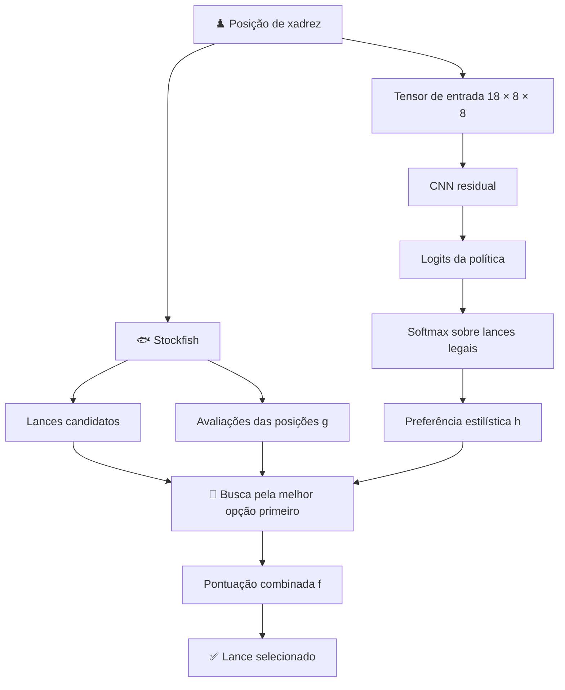

 

### ♟️ Aprendendo como um agente escolhe, não apenas o que escolhe.

*Um agente híbrido de xadrez que combina aprendizado profundo e busca heurística para estudar a tomada de decisões estilísticas.*

[Visão geral](#-visão-geral) •
[Arquitetura](#-arquitetura) •
[Rede neural](#-rede-neural) •
[Treinamento](#-metodologia-de-treinamento) •
[Busca](#-busca-heurística) •
[Experimentos](#-desenho-experimental) •
[Plano de desenvolvimento](#-plano-de-desenvolvimento)

---

## 📑 Sumário

| | Seção | | Seção |
|---|---|---|---|
| 1 | [Visão geral](#-visão-geral) | 7 | [Busca heurística](#-busca-heurística) |
| 2 | [Status do projeto](#-status-do-projeto) | 8 | [Desenho experimental](#-desenho-experimental) |
| 3 | [Objetivo da pesquisa](#-objetivo-da-pesquisa) | 9 | [Métricas de avaliação](#-métricas-de-avaliação) |
| 4 | [Arquitetura](#-arquitetura) | 10 | [Notação](#-notação) |
| 5 | [Rede neural](#-rede-neural) | 11 | [Limitações](#-limitações) |
| 6 | [Metodologia de treinamento](#-metodologia-de-treinamento) | 12 | [Tecnologia](#-tecnologia) · [Plano de desenvolvimento](#-plano-de-desenvolvimento) |

---

## 🔭 Visão geral

**KAIROS** é um projeto acadêmico de Ciência da Computação que investiga a integração entre **aprendizado de máquina e inteligência artificial clássica** por meio do xadrez.

O projeto estuda se um agente consegue aprender diferentes estilos de jogo a partir de partidas humanas e reproduzir esses estilos, mantendo, ao mesmo tempo, uma qualidade objetiva de jogo razoável.

> [!IMPORTANT]
> Em vez de tentar superar o Stockfish, o KAIROS faz uma pergunta diferente:
>
> **É possível aprender, controlar e medir a tomada de decisões estilísticas independentemente da qualidade objetiva dos lances?**

O sistema combina três componentes:

| Componente | Função |
|---|---|
| 🐟 **Stockfish** | Gera lances candidatos, avalia posições e fornece continuações. |
| 🧠 **Política neural** | Aprende preferências de lances a partir de partidas humanas e problemas táticos. |
| 🔎 **Busca pela melhor opção primeiro (Best-First Search)** | Explora continuações candidatas com uma heurística que combina avaliação objetiva e preferência estilística aprendida. |

A ideia central é tornar a compensação entre esses dois sinais **explícita e experimentalmente mensurável**.

---

## 🚧 Status do projeto

> [!NOTE]
> **Em desenvolvimento — protótipo de pesquisa.**
>
> Este repositório documenta a arquitetura, a formulação matemática, a metodologia de treinamento e o desenho experimental do KAIROS. A base de código completa, os pesos treinados, os conjuntos de dados e os artefatos necessários para reproduzir os experimentos **ainda não foram publicados** como um lançamento completo.
>
> As hipóteses experimentais **não** são apresentadas como resultados confirmados.

---

## 🎯 Objetivo da pesquisa

> **Um agente de xadrez consegue aprender estilos de jogo distintos e expressá-los por meio de suas decisões, com uma compensação mensurável entre preferência estilística e qualidade objetiva dos lances?**

Duas dimensões complementares são investigadas:

| Dimensão | Pergunta |
|---|---|
| **Qualidade objetiva** | Até que ponto o lance selecionado coincide com o lance preferido pelo Stockfish e quanta avaliação é perdida quando o agente diverge? |
| **Comportamento estilístico** | As decisões do agente refletem padrões aprendidos de diferentes grupos de jogadores humanos? |

Seja \(s\) uma posição de xadrez e \(a\) um lance legal em \(s\). Dois sinais são combinados:

$$
g(s,a) = \mathrm{avaliação\ objetiva}, \qquad
h(s,a) = \mathrm{preferência\ por\ lances\ aprendida}
$$

A decisão final maximiza uma pontuação combinada \(F\) sobre os lances candidatos seguros:

$$
a^\star = \arg\max_{a \in A_{\mathrm{safe}}(s)} F(a)
$$

O experimento investiga como a alteração da contribuição relativa de \(h\) afeta a seleção de lances, as estatísticas comportamentais e a avaliação objetiva.

---

## 🏗️ Arquitetura

O Stockfish participa tanto da geração de candidatos quanto da avaliação das posições exploradas. A política neural fornece um sinal de preferência aprendido, enquanto a busca organiza a exploração e a comparação das alternativas.

### Responsabilidades dos componentes

| Componente | Responsabilidade |
|---|---|
| Rede neural | Estima preferências entre lances legais. |
| Stockfish | Gera candidatos e avalia posições. |
| Filtro de segurança | Remove candidatos que ultrapassam os limites de segurança configurados. |
| Busca pela melhor opção primeiro | Prioriza e expande nós promissores. |
| Pipeline de avaliação | Mede divergência, custo em centipawns e diferenças comportamentais. |

---

## 🧠 Rede neural

O KAIROS utiliza uma rede neural convolucional residual (CNN) adaptada à estrutura espacial de um tabuleiro de xadrez.

### Representação de entrada

$$
X \in \mathbb{R}^{18 \times 8 \times 8}
$$

Os 18 planos codificam o estado do tabuleiro; as duas dimensões restantes correspondem às 64 casas. O significado exato e a ordem dos planos são definidos pelo codificador de posições do projeto.

### Arquitetura-base

| # | Etapa |
|---|---|
| 1 | Camada convolucional inicial que mapeia 18 canais de entrada para 128 canais. |
| 2 | Dez blocos residuais. |
| 3 | Duas convoluções \(3 \times 3\) por bloco residual. |
| 4 | Normalização em lote (*Batch Normalization*) e ativações ReLU. |
| 5 | Atenção entre canais por Squeeze-and-Excitation (SE). |
| 6 | Uma cabeça principal de política e cabeças auxiliares de predição. |

A arquitetura-base produz uma representação de características

$$
H_\theta(X) \in \mathbb{R}^{128 \times 8 \times 8}
$$

em que \(\theta\) representa os parâmetros treináveis.

### Conexões residuais

Um bloco residual aprende uma transformação \(R(x)\) e a adiciona à sua entrada:

$$
x_{\mathrm{out}} = \mathrm{ReLU}\bigl(x + R(x)\bigr)
$$

A conexão de atalho permite que o bloco preserve informações de sua entrada, em vez de reconstruir toda a representação, facilitando a otimização de redes mais profundas.

### Atenção Squeeze-and-Excitation

Os módulos SE aprendem a importância relativa dos canais de características.

**Compressão (*Squeeze*)** — cada canal \(c\) é resumido por meio de uma média global:

$$
z_c = \frac{1}{64} \sum_{i=1}^{8} \sum_{j=1}^{8} x_{c,i,j}
$$

**Excitação (*Excitation*)** — os descritores passam por uma pequena rede de controle:

$$
w = \sigma\bigl(W_2 \mathrm{ReLU}(W_1 z)\bigr)
$$

**Recalibração (*Recalibration*)** — o mapa de características é reescalado canal a canal:

$$
\widetilde{x}_{c,i,j} = w_c \, x_{c,i,j}
$$

| Símbolo | Significado |
|---|---|
| \(z \in \mathbb{R}^{C}\) | Vetor de descritores dos canais. |
| \(W_1, W_2\) | Matrizes de pesos aprendidas. |
| \(\sigma\) | Função sigmoide. |
| \(w_c \in (0,1)\) | Peso atribuído ao canal \(c\). |

### Cabeça principal de política

A cabeça principal mapeia a representação da arquitetura-base para 1.968 logits de ações:

$$
\mathbf{z}_\theta(s) \in \mathbb{R}^{1968}
$$

Cada logit é a pontuação não normalizada de uma classe de ação. Os logits **não são** probabilidades; um logit maior indica uma preferência relativa maior antes da normalização. A representação de ações da rede define como as 1.968 classes são mapeadas para os lances.

### Cabeças auxiliares

| Cabeça | Classes de saída | Finalidade |
|---|---:|---|
| Origem do lance | 64 | Pontua a casa de origem. |
| Destino do lance | 64 | Pontua a casa de destino. |
| Fase da partida | 3 | Prevê a fase da partida. |
| Tipo de lance | 4 | Prevê a categoria de lance configurada. |
| Casas de origem legais | 64 | Prevê as casas de origem legais. |
| Casas de destino legais | 64 | Prevê as casas de destino legais. |
| Temas dos problemas | 9 | Prevê temas táticos em exemplos de problemas. |

As cabeças de origem e destino também contribuem para o logit principal de política de uma ação \(a\):

$$
z(a) = z_{\mathrm{policy}}(a) + z_{\mathrm{from}}\bigl(\mathrm{src}(a)\bigr) + z_{\mathrm{to}}\bigl(\mathrm{dst}(a)\bigr)
$$

em que \(\mathrm{src}(a)\) e \(\mathrm{dst}(a)\) são as casas de origem e destino de \(a\). As predições auxiliares fornecem supervisão adicional durante o treinamento; elas não substituem a saída principal da política.

### Probabilidades da política

**Softmax sobre lances legais.** Seja \(A(s)\) o conjunto de lances legais em \(s\). A probabilidade atribuída pela política a um lance legal \(a_i\) é

$$
\pi_\theta(a_i \mid s) = \frac{\exp(z_i)}{\sum_{a_j \in A(s)} \exp(z_j)}
$$

em que \(z_i\) é o logit de \(a_i\). O denominador considera apenas lances legais, de modo que

$$
\sum_{a \in A(s)} \pi_\theta(a \mid s) = 1
$$

> [!WARNING]
> Essas probabilidades expressam preferências relativas entre lances legais. Elas **não** são estimativas da probabilidade de vitória, da avaliação em centipawns ou da probabilidade de um lance ser objetivamente ótimo.

**Pontuação de log-probabilidade.** A busca utiliza o logaritmo da probabilidade da política:

$$
h(s,a) = \log \pi_\theta(a \mid s) \;\le\; 0
$$

Um valor maior significa que a política prefere mais aquele lance. Por exemplo, com probabilidades de \(0.50\) e \(0.10\):

$$
\log 0.50 \approx -0.693 \;>\; \log 0.10 \approx -2.303
$$

O logaritmo preserva a ordenação das probabilidades e é a grandeza natural em objetivos de entropia cruzada.

---

## 🏋️ Metodologia de treinamento

O pipeline combina **partidas humanas de xadrez** (exemplos de seleção de lances) e **posições de problemas táticos** (supervisão tática adicional). O objetivo é aprender uma política que reproduza padrões presentes nos dados de treinamento, em vez de aproximar o lance mais bem classificado pelo Stockfish.

### Função de perda multitarefa

$$
\begin{aligned}
\mathcal{L} ={}& \mathcal{L}_{\mathrm{policy}} + 0.2\,\mathcal{L}_{\mathrm{from}} + 0.2\,\mathcal{L}_{\mathrm{to}} \\
&+ 0.1\,\mathcal{L}_{\mathrm{phase}} + 0.2\,\mathcal{L}_{\mathrm{type}} \\
&+ 0.2\,\mathcal{L}_{\mathrm{legal}} + 0.1\,\mathcal{L}_{\mathrm{theme}}
\end{aligned}
$$

A perda de temas é aplicada somente aos exemplos de problemas. Os coeficientes determinam a intensidade com que cada tarefa contribui.

### Entropia cruzada da política

Para um exemplo de treinamento \((s_i, y_i)\), cujo lance-alvo é \(y_i\):

$$
\mathcal{L}_{\mathrm{policy}} = -\frac{1}{N} \sum_{i=1}^{N} \log \pi_\theta(y_i \mid s_i)
$$

O modelo é penalizado quando atribui baixa probabilidade ao lance observado.

> [!NOTE]
> Trata-se de aprendizado supervisionado a partir de lances selecionados. Isso, por si só, não é aprendizado por reforço: o objetivo não exige interação baseada em recompensas nem partidas entre versões do próprio agente (*self-play*).

### Perdas de classificação auxiliares

Para uma tarefa categórica com \(K\) classes, distribuição-alvo \(q\) e predição \(p\):

$$
\mathcal{L}_{\mathrm{CE}} = -\sum_{k=1}^{K} q_k \log p_k
$$

Nas tarefas de rótulo único, o alvo é *one-hot*, de modo que isso se reduz a \(-\log p_{k^\star}\) para a classe correta \(k^\star\). Nas tarefas multirrótulo, a perda apropriada depende da representação efetiva do alvo e da implementação.

<b>⚙️ Detalhes da otimização</b> — AdamW, programação da taxa de aprendizado, limitação do gradiente, EMA

 

#### AdamW

Hiperparâmetros:

$$
\eta_0 = 10^{-3}, \qquad \beta_1 = 0.9, \qquad \beta_2 = 0.98
$$

O Adam mantém estimativas móveis do gradiente \(\nabla_t = \nabla_\theta \mathcal{L}_t\) e de seu quadrado:

$$
m_t = \beta_1 m_{t-1} + (1-\beta_1)\,\nabla_t
$$

$$
v_t = \beta_2 v_{t-1} + (1-\beta_2)\,\nabla_t^{2}
$$

com correção de viés:

$$
\widehat{m}_t = \frac{m_t}{1-\beta_1^{\,t}}, \qquad
\widehat{v}_t = \frac{v_t}{1-\beta_2^{\,t}}
$$

Uma atualização simplificada do AdamW, com coeficiente de decaimento de pesos desacoplado \(\gamma\):

$$
\theta_{t+1} = \theta_t
- \eta_t \frac{\widehat{m}_t}{\sqrt{\widehat{v}_t} + \epsilon}
- \eta_t \, \gamma \, \theta_t
$$

A implementação aplica decaimento de pesos somente aos parâmetros com mais de uma dimensão.

#### Programação da taxa de aprendizado

Aquecimento linear (*warmup*) ao longo de \(T_w = 1000\) etapas, seguido de decaimento cossenoidal até 2% da taxa inicial.

$$
\eta_t = \eta_0 \, \frac{t}{T_w}, \qquad 0 \le t \le T_w
$$

Para \(t > T_w\), com total de etapas \(T\) e progresso normalizado \(u = \dfrac{t - T_w}{T - T_w} \in [0,1]\):

$$
\eta(u) = \eta_{\min} + \frac{\eta_0 - \eta_{\min}}{2}\bigl(1 + \cos(\pi u)\bigr),
\qquad \eta_{\min} = 0.02\,\eta_0 = 2 \times 10^{-5}
$$

#### Limitação do gradiente

Com vetor gradiente \(\mathbf{G}\) e norma máxima \(c = 1.0\):

$$
\mathbf{G}' = \mathbf{G} \cdot \min\!\left(1, \frac{c}{\lVert \mathbf{G} \rVert_2}\right)
$$

Se a norma já estiver abaixo de \(c\), o gradiente permanece inalterado; caso contrário, ele é reescalado.

#### Média móvel exponencial (EMA)

$$
\theta_t^{\mathrm{EMA}} = \delta_t \, \theta_{t-1}^{\mathrm{EMA}} + (1-\delta_t)\,\theta_t,
\qquad
\delta_t = \min\!\left(0.999, \frac{1+t}{10+t}\right)
$$

A taxa de decaimento-alvo é 0.999. A EMA reduz a influência de etapas individuais de otimização; os pesos médios são utilizados para validação, seleção de checkpoints e avaliação final.

### Validação e teste

Durante o treinamento, o modelo é avaliado a cada época em um subconjunto fixo de validação com até 200.000 posições. O checkpoint é selecionado pela acurácia geral *top-1* na validação. Em seguida, o modelo EMA selecionado é avaliado no conjunto de teste completo, e as métricas são salvas separadamente.

| Divisão | Finalidade |
|---|---|
| **Treinamento** | Atualiza os parâmetros. |
| **Validação** | Orienta a seleção do modelo e as decisões sobre hiperparâmetros. |
| **Teste** | Mede o desempenho em dados não utilizados no treinamento. |

> [!CAUTION]
> O conjunto de teste não deve ser utilizado repetidamente para escolher o melhor modelo; isso compromete seu papel como conjunto de avaliação independente.

---

## 🎭 Políticas estilísticas

O KAIROS investiga duas políticas estilísticas principais.

| | 🔥 Política romântica | 🏛️ Política posicional |
|---|---|---|
| **Corpus** | Paul Morphy · Mikhail Tal · Garry Kasparov | Anatoly Karpov · Tigran Petrosian · José Raúl Capablanca |
| **Somente referência** | Adolf Anderssen (referência histórica, excluída do corpus principal de ajuste fino) | — |

Esses jogadores fornecem exemplos para aprender conjuntos contrastantes de padrões de decisão. As categorias são **definições operacionais** para o experimento e não implicam que todas as partidas de um jogador pertençam inequivocamente a um único estilo.

### Avaliação de Fischer

As partidas de Bobby Fischer são utilizadas como **referência qualitativa independente**, em vez de serem atribuídas a qualquer uma das categorias de treinamento. Isso ajuda a examinar como as políticas se comportam em posições externas ao esquema explícito de classificação entre romântico e posicional. Por si só, isso não demonstra generalização para todos os jogadores ou posições não vistos.

---

## 🔎 Busca heurística

A busca é uma **busca pela melhor opção primeiro (*Best-First Search*)**: uma técnica clássica de IA que mantém uma fronteira de nós e expande aquele que apresenta a maior prioridade. O KAIROS utiliza uma função de pontuação especializada, em vez da formulação convencional de custo do A*.

### Geração de candidatos

| Etapa | Configuração |
|---|---|
| Candidatos da raiz | Até **12** variantes principais por meio de MultiPV, com busca de **5.000** nós. |
| Filtro de segurança | Remove candidatos que permitem mate forçado contra o agente ou perdem mais de **600 cp** em relação ao melhor candidato. |
| Alternativa de segurança | Se nenhum candidato sobreviver, o candidato mais bem classificado é mantido. |
| Nós internos | Até **6** candidatos do Stockfish. |

Essas configurações são parâmetros computacionais, não garantias de otimalidade.

### Sinal objetivo

Seja \(g(s,a)\) a avaliação do Stockfish, em centipawns, associada a um candidato. Ela é limitada para reduzir a influência de valores extremos:

$$
g_{\mathrm{clip}}(s,a) = \max\bigl(-1000,\; \min(1000,\; g(s,a))\bigr)
$$

O valor em centipawns é uma avaliação do motor, não uma probabilidade direta de vitória.

### Sinal estilístico

Para um único lance:

$$
h(s,a) = \log \pi_\theta(a \mid s)
$$

Em nós mais profundos, a busca calcula a média da log-probabilidade ao longo dos lances do próprio agente no caminho explorado até o nó \(n\):

$$
h_{\mathrm{path}}(n) = \frac{1}{m} \sum_{i=1}^{m} \log \pi_\theta(a_i \mid s_i)
$$

em que \(m\) é o número de lances do agente no caminho. Isso calcula a média do sinal da política, em vez de somá-lo. O tratamento exato da raiz e dos nós individuais do caminho segue a implementação. A partir daqui, \(h(n) \equiv h_{\mathrm{path}}(n)\), e \(g(n)\) é a avaliação do Stockfish para o nó \(n\), após a limitação dos valores.

### Normalização

Os sinais brutos têm significados e unidades diferentes: \(g\) é uma avaliação do motor em centipawns, enquanto \(h\) é uma log-probabilidade. Somá-los diretamente faria com que sua influência relativa dependesse de diferenças arbitrárias de escala.

O KAIROS padroniza cada sinal usando estatísticas do **conjunto de candidatos da raiz**:

$$
\mu_g,\ \mu_h : \mathrm{médias}, \qquad
\sigma_g = \max\bigl(\widehat{\sigma}_g,\ 25\bigr), \qquad
\sigma_h = \max\bigl(\widehat{\sigma}_h,\ 0.25\bigr)
$$

em que \(\widehat{\sigma}_g\) e \(\widehat{\sigma}_h\) são os desvios-padrão dos candidatos da raiz, e os limites mínimos (25 cp e 0.25) evitam divisões por valores muito pequenos. Os mesmos parâmetros da raiz são reutilizados nos nós mais profundos, de modo que as pontuações compartilhem uma escala comum.

### Função de avaliação combinada

$$
f(n) = \underbrace{\frac{g(n) - \mu_g}{\sigma_g}}_{g'(n)} \;+ \;
\lambda\, \underbrace{\frac{h(n) - \mu_h}{\sigma_h}}_{h'(n)}
$$

| Símbolo | Significado |
|---|---|
| \(n\) | Um nó na árvore de busca explorada. |
| \(g(n)\) | Sinal de avaliação objetiva do Stockfish. |
| \(h(n)\) | Sinal de preferência da política neural. |
| \(\mu_g,\ \mu_h\) | Médias dos candidatos da raiz. |
| \(\sigma_g,\ \sigma_h\) | Escalas de normalização da raiz, com limites mínimos. |
| \(\lambda\) | Peso relativo da preferência estilística. |
| \(f(n)\) | Pontuação de prioridade utilizada pela busca. |

A busca maximiza \(f(n)\), portanto seu comportamento depende da convenção de sinais e da perspectiva utilizada para representar as avaliações do Stockfish na implementação.

### O papel de λ

O experimento testa

$$
\lambda \in \{0,\ 0.25,\ 0.5,\ 1,\ 2,\ 4\}
$$

- **\(\lambda = 0\)** — o termo estilístico desaparece, \(f(n) = g'(n)\). Na raiz, a implementação utiliza diretamente o lance mais bem classificado pelo Stockfish como controle.
- **\(\lambda > 0\)** — a política contribui para a classificação: \(f(n) = g'(n) + \lambda\, h'(n)\).

Aumentar \(\lambda\) atribui um coeficiente maior à política, mas não garante que cada lance individual mude de forma monotônica nem que o lance selecionado se torne objetivamente pior.

### Expansão pela melhor opção primeiro

A fronteira é uma fila de prioridade implementada como um *heap*. Em cada iteração:

1. Seleciona o nó da fronteira com o maior \(f(n)\).
2. Consulta o Stockfish para obter continuações candidatas.
3. Aplica cada candidato e a resposta correspondente do Stockfish.
4. Calcula os sinais objetivo e da política dos nós resultantes.
5. Atualiza a melhor pontuação encontrada para o lance correspondente da raiz.
6. Insere os sucessores elegíveis na fronteira.

A configuração atual utiliza um **orçamento de expansão de 6** e uma **profundidade máxima de 3** lances do próprio agente. Um orçamento igual a zero avalia apenas a raiz.

### Seleção do lance na raiz

Seja \(T(a)\) a subárvore explorada do lance da raiz \(a\). Sua pontuação é

$$
F(a) = \max_{n \in T(a)} f(n)
$$

e o lance selecionado é

$$
a^\star = \arg\max_{a \in A_{\mathrm{safe}}(s)} F(a)
$$

em que \(A_{\mathrm{safe}}(s)\) é o conjunto de candidatos seguros na raiz.

> [!NOTE]
> Este é um critério de máximo sobre a subárvore explorada, **não** um minimax exaustivo: a busca não minimiza independentemente o objetivo sobre todas as respostas possíveis do oponente. O Stockfish fornece as respostas utilizadas para avançar pelas posições exploradas.

### Diferença em relação ao A*

No A* convencional:

$$
f_{\mathrm{A}^\*}(n) = c_{\mathrm{path}}(n) + \hat{c}_{\mathrm{goal}}(n)
$$

em que \(c_{\mathrm{path}}(n)\) é o custo acumulado do caminho e \(\hat{c}_{\mathrm{goal}}(n)\) estima o custo restante até um objetivo.

| | A* | KAIROS |
|---|---|---|
| Primeiro termo | Custo acumulado do caminho | Avaliação objetiva do motor \(g\) |
| Segundo termo | Estimativa heurística até o objetivo | Preferência estilística aprendida \(h\) |

O KAIROS é uma busca pela melhor opção primeiro com uma heurística específica do domínio, não uma implementação convencional de A*.

---

## 🧪 Desenho experimental

O experimento de busca avalia como a alteração do peso estilístico \(\lambda\) afeta as decisões das duas políticas.

### Seleção de posições críticas

1. Carregar posições de um conjunto de dados JSONL.
2. Remover posições FEN duplicadas e embaralhar.
3. Manter posições nas quais **pelo menos 3 candidatos seguros** estejam a até **150 cp** do melhor candidato.
4. Examinar até quatro vezes o número de posições solicitado; reter **500** posições críticas.

Isso concentra o experimento em posições com várias alternativas competitivas. O número exato de posições utilizáveis depende do conjunto de dados e dos critérios de filtragem.

### H1 — Influência estilística

> **Hipótese:** aumentar \(\lambda\) aumenta a divergência em relação ao lance mais bem classificado pelo Stockfish.

Seja \(a_i^\star(\lambda)\) o lance selecionado e \(a_i^{\mathrm{SF}}\) o lance mais bem classificado pelo Stockfish na posição \(i\):

$$
D_i(\lambda) = \mathbf{1}\bigl[\,a_i^\star(\lambda) \neq a_i^{\mathrm{SF}}\,\bigr],
\qquad
\widehat{D}(\lambda) = \frac{1}{N} \sum_{i=1}^{N} D_i(\lambda)
$$

A taxa de divergência \(\widehat{D}(\lambda) \in [0,1]\) é registrada por política e por valor de \(\lambda\); o experimento testa se ela aumenta monotonicamente ao longo dos valores configurados.

> [!NOTE]
> Uma taxa de divergência maior mostra que o sistema seleciona lances diferentes com mais frequência. Isso não demonstra que esses lances sejam estilisticamente autênticos.

#### Custo em centipawns

Seja \(C_i^{\mathrm{SF}}\) a avaliação do lance mais bem classificado pelo Stockfish, após a limitação dos valores, e \(C_i^{\mathrm{sel}}\) a avaliação do lance selecionado, utilizando uma perspectiva e uma convenção de pontuação consistentes:

$$
\mathrm{cost}_i = C_i^{\mathrm{SF}} - C_i^{\mathrm{sel}}
$$

$$
\overline{\mathrm{cost}} = \frac{1}{N} \sum_{i=1}^{N} \mathrm{cost}_i,
\qquad
\overline{\mathrm{cost}}_{\mathrm{div}} = \frac{\sum_{i=1}^{N} D_i \mathrm{cost}_i}{\sum_{i=1}^{N} D_i}
$$

A média condicional \(\overline{\mathrm{cost}}_{\mathrm{div}}\) isola as posições nas quais o KAIROS se afasta do lance mais bem classificado pelo Stockfish. Se nenhuma posição apresentar divergência, ela é indefinida e deve ser reportada como *indisponível*, não como zero. O custo em centipawns é relativo ao motor; não constitui uma medida completa da qualidade estratégica, da dificuldade prática ou do estilo.

#### Métricas comportamentais

Para uma propriedade binária \(B_i\) do lance selecionado (por exemplo, dar xeque), a taxa observada é

$$
\widehat{B} = \frac{1}{N} \sum_{i=1}^{N} B_i
$$

Propriedades acompanhadas: **capturas**, **xeques**, **sacrifícios**, **lances tranquilos**. As regras de classificação dos sacrifícios e dos lances tranquilos são definidas pela implementação de avaliação e não devem ser interpretadas como classificações universais do xadrez.

### H2 — Diferenças entre as políticas

> **Hipótese:** as políticas romântica e posicional produzem comportamentos mensuravelmente diferentes nas mesmas posições.

Para uma métrica \(M\), a diferença pareada na posição \(i\) e sua média são

$$
\Delta_i = M_i^{\mathrm{rom}} - M_i^{\mathrm{pos}},
\qquad
\overline{\Delta} = \frac{1}{N} \sum_{i=1}^{N} \Delta_i
$$

Uma \(\overline{\Delta}\) positiva significa que a métrica é maior para a política romântica; um valor negativo, para a política posicional. O desenho pareado controla as diferenças entre posições porque ambas as políticas são comparadas no mesmo conjunto.

As diferenças pareadas são calculadas para divergência, custo em centipawns, capturas, xeques e sacrifícios, e avaliadas com intervalos de confiança por *bootstrap*.

### Intervalos de confiança por bootstrap

1. Amostrar \(N\) observações **com reposição** entre as posições avaliadas.
2. Calcular a estatística na reamostragem.
3. Repetir para muitas amostras de *bootstrap*.
4. Utilizar a distribuição resultante para estimar os limites de confiança.

Para um intervalo percentil de 95%, com estimativas de *bootstrap* \(\widehat{M}^{\*}\):

$$
\mathrm{CI}_{95\%} =
\left[
Q_{0.025}\left(\widehat{M}^{\*}\right),
Q_{0.975}\left(\widehat{M}^{\*}\right)
\right]
$$

em que \(Q_p\) é o quantil de ordem \(p\).

> [!WARNING]
> - Para comparações pareadas, o *bootstrap* deve **preservar o pareamento**, reamostrando as diferenças pareadas ou reamostrando conjuntamente ambas as medições.
> - Um intervalo que exclui zero indica evidência de uma diferença diferente de zero; não estabelece importância prática nem validade causal.
> - As posições podem apresentar dependência estatística, portanto os intervalos devem ser interpretados à luz do desenho amostral e de eventuais dependências entre partidas repetidas ou fontes de dados.

---

## 📊 Métricas de avaliação

O modelo neural e o sistema de busca são avaliados **separadamente**.

### Métricas da política neural

**Acurácia top-1** — o lance com maior probabilidade corresponde ao alvo:

$$
\mathrm{Top1} = \frac{1}{N} \sum_{i=1}^{N} \mathbf{1}\Bigl[\arg\max_{a \in A(s_i)} \pi_\theta(a \mid s_i) = y_i\Bigr]
$$

**Acurácia top-3** — o alvo está entre os três lances legais mais bem classificados:

$$
\mathrm{Top3} = \frac{1}{N} \sum_{i=1}^{N} \mathbf{1}\bigl[\,y_i \in \mathrm{Top3}(s_i)\,\bigr]
$$

**Log-verossimilhança negativa (NLL)** — valores menores significam maior probabilidade atribuída aos lances observados:

$$
\text{NLL} = -\frac{1}{N} \sum_{i=1}^{N} \log \pi_\theta(y_i \mid s_i)
$$

A avaliação é estratificada por fonte de dados, fase da partida, combinações entre fonte e fase e tipo de lance, para revelar diferenças ocultadas por métricas agregadas.

### Métricas da busca

- Divergência em relação ao lance mais bem classificado pelo Stockfish.
- Custo médio em centipawns e custo médio entre decisões divergentes.
- Frequências de capturas, xeques, sacrifícios e lances tranquilos.
- Intervalos de confiança por *bootstrap*.
- Diferenças pareadas entre políticas estilísticas.

> [!TIP]
> A acurácia top-1 e a divergência da busca são **medidas diferentes**. A primeira avalia a predição em relação aos lances humanos registrados; a segunda mede se a decisão final da busca se afasta do lance preferido pelo Stockfish.

---

## 🔣 Notação

| Símbolo | Definição |
|---|---|
| \(s\) | Posição de xadrez. |
| \(a\) | Lance candidato legal. |
| \(A(s)\) | Lances legais na posição \(s\). |
| \(A_{\mathrm{safe}}(s)\) | Candidatos mantidos pelo filtro de segurança. |
| \(X\) | Tensor de entrada da rede neural. |
| \(\theta\) | Parâmetros da rede neural. |
| \(z_i\) | Logit da classe de ação \(i\). |
| \(\pi_\theta(a \mid s)\) | Probabilidade da política neural. |
| \(g(s,a)\), \(g(n)\) | Sinal de avaliação objetiva do Stockfish, com valores limitados. |
| \(h(s,a)\), \(h(n)\) | Sinal de log-probabilidade da política neural, com média do caminho no nó \(n\). |
| \(\mu_g,\ \mu_h\) | Médias dos candidatos da raiz utilizadas na normalização. |
| \(\sigma_g,\ \sigma_h\) | Desvios-padrão dos candidatos da raiz com limites mínimos. |
| \(\lambda\) | Coeficiente relativo da preferência estilística. |
| \(f(n)\) | Pontuação de prioridade utilizada para expandir um nó da busca. |
| \(F(a)\) | Melhor pontuação encontrada na subárvore explorada do lance da raiz \(a\). |
| \(a^\star\) | Lance selecionado pela busca. |
| \(a^{\mathrm{SF}}\) | Lance mais bem classificado pelo Stockfish. |
| \(y_i\) | Lance-alvo humano no exemplo de treinamento \(i\). |
| \(D_i\) | Indicador de que o lance selecionado difere do lance mais bem classificado pelo Stockfish. |
| \(N\) | Número de posições avaliadas. |
| \(\Delta_i\) | Diferença pareada de uma métrica entre as políticas. |
| \(\mathcal{L}\) | Perda total do treinamento multitarefa. |
| \(\eta_t\) | Taxa de aprendizado na etapa de treinamento \(t\). |
| \(\gamma\) | Coeficiente de decaimento de pesos desacoplado. |
| \(\delta_t\) | Taxa de decaimento da EMA na etapa \(t\). |
| \(\theta^{\mathrm{EMA}}\) | Média móvel exponencial dos parâmetros do modelo. |

---

## ⚠️ Limitações

O KAIROS é um protótipo de pesquisa, e suas conclusões dependem do desenho experimental.

| Limitação | Descrição |
|---|---|
| **O estilo é operacionalizado por meio dos dados** | Os corpora de jogadores são aproximações das categorias estilísticas, não uma verdade fundamental para uma taxonomia universal dos estilos de xadrez. |
| **O Stockfish é uma referência, não um oráculo** | Suas avaliações dependem das configurações do motor, dos limites de busca e da posição analisada. |
| **O conjunto de candidatos restringe a busca** | Em condições normais, lances excluídos pela geração de candidatos ou pelo filtro de segurança não podem ser selecionados. |
| **A busca pela melhor opção primeiro é limitada** | Um orçamento limitado não garante que a melhor continuação seja encontrada. |
| **A pontuação não é uma utilidade calibrada** | A padronização torna os sinais comparáveis em escala, mas não comprova que sua combinação represente uma compensação ótima. |
| **Os indicadores comportamentais são incompletos** | As frequências de capturas, xeques, sacrifícios e lances tranquilos não conseguem estabelecer, de forma independente, a autenticidade estilística. |
| **A avaliação independente tem limitações** | As posições de Fischer são uma referência qualitativa, não uma prova de generalização. |
| **Significância não é suficiente** | Também devem ser considerados os tamanhos dos efeitos, a incerteza, a dependência dos dados e os controles experimentais. |

---

## 🛠️ Tecnologia

| Ferramenta | Utilização |
|---|---|
| **Python** | Treinamento, inferência, orquestração da busca e avaliação. |
| **PyTorch** | Implementação e otimização da rede neural. |
| **Stockfish** | Geração de candidatos, avaliação pelo motor e variantes principais. |
| **PGN** | Representação de partidas de xadrez. |
| **JSONL / JSON** | Entradas experimentais, configurações e artefatos de resultados. |

---

## 🗺️ Plano de desenvolvimento

- [x] Definir a arquitetura híbrida de política neural e busca heurística.
- [x] Estabelecer os objetivos de treinamento e as métricas de avaliação.
- [x] Implementar o experimento de busca parametrizada.
- [ ] Organizar a base de código para lançamento público.
- [ ] Documentar os requisitos de instalação e execução.
- [ ] Publicar configurações reproduzíveis de treinamento e busca.
- [ ] Documentar as fontes de dados, o pré-processamento e a construção das divisões.
- [ ] Consolidar os resultados experimentais e os intervalos de confiança.
- [ ] Disponibilizar checkpoints selecionados e exemplos de inferência.
- [ ] Adicionar testes para as saídas do modelo, o tratamento de lances legais e o comportamento da busca.

---

## 💡 Filosofia do projeto

O KAIROS investiga a distinção entre **escolher um lance forte** e **escolher um lance coerente com uma preferência comportamental aprendida**.

Sua contribuição central é o estudo experimental de como uma política neural pode influenciar um procedimento de busca clássico, utilizando as avaliações objetivas do motor como referência para as consequências dessa influência.

O objetivo não é substituir a análise objetiva do xadrez pela imitação, mas tornar a tomada de decisões estilísticas um componente explícito e mensurável de um sistema de IA.

---

*Aprendendo como um agente escolhe, não apenas o que escolhe.*

